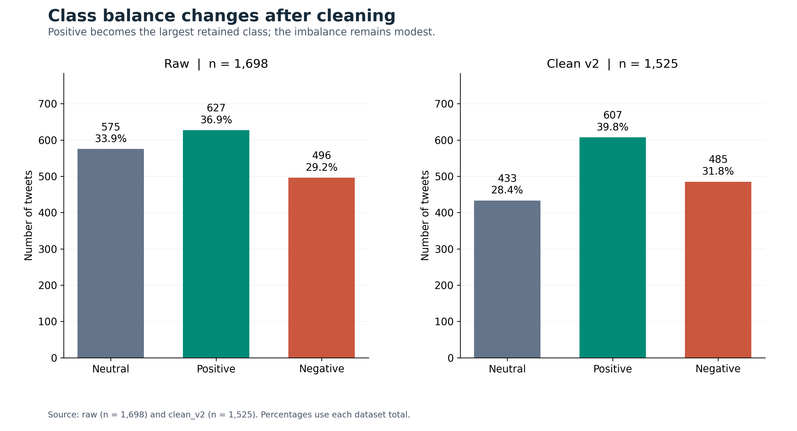
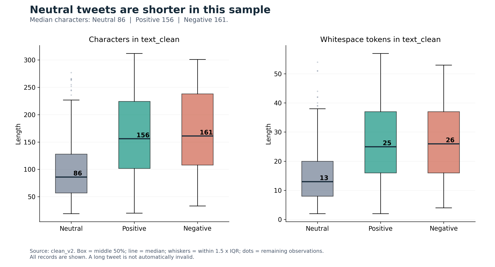
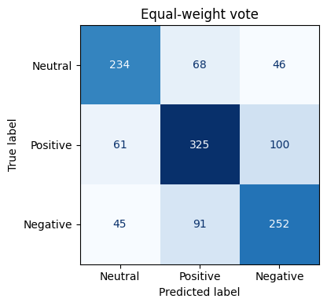

# Project team

| Student | ID |
|---|---|
| FENG Dingran | 24128996D |
| GU Kailei | 24102618D |
| CHOI CHUN MAN | 24133223D |
| YANG Qitian | 24128112D |
| CAO Taihe | 24101734D |
| YU Guanlin | 24107216D |

# Abstract

We classify English-language stock-market-crash tweets as neutral, positive or negative for an analyst-facing decision-support workflow. Cleaning retains 1,525 of 1,698 records. We use five grouped development folds to prevent related tweets from appearing on both sides of a fold. Fixed TF-IDF logistic regression achieves 58.20% pooled out-of-fold Macro-F1. Nested tuning raises it to 61.35%, close to the archived TextCNN workflow's 61.79%. Their equal-weight probability average reaches 66.39% on the same development records. This combination was proposed after inspecting development results and needs independent validation. A rule-based diagnostic agrees with 92.06% of the supplied development labels on raw text, suggesting that vocabulary cues may help explain the strong linear reference.

**Keywords** stock-market sentiment, grouped validation, text classification, decision support

# 1 Introduction and Dataset

## 1.1 Background and decision problem

A research analyst monitoring a market sell-off can use sentiment summaries to find unusual narrative shifts and prioritize tweets for review. A short post can express sentiment about one token, describe a wider market move, or quote someone else's position. Users should inspect the underlying text and corroborate a pattern before drawing a market conclusion.

## 1.2 Project objectives

Predict three supplied sentiment classes and compare six analytical model families with a TF-IDF logistic-regression reference. Compare using pooled development OOF Macro-F1 with identical group assignments. Report differences between fixed-config evaluations, nested selection estimates and historical same-fold model selection.

## 1.3 Dataset description

**Table 1. Dataset overview**

| Attribute | Value |
|---|---|
| Source | Course-provided Dataset 3, *Huge Crash in the Stock Market* |
| Time and domain | 2022 tweets concerning stock-market crashes and bear markets |
| Unit and size | A tweet. 1,698 raw records, 1,525 retained in clean_v2 |
| Target | 0 Neutral, 1 Positive, 2 Negative |
| Provenance | Labels supplied with the dataset. Their original annotation method is unconfirmed |

**Table 2. Data dictionary**

| Field | Type | Role |
|---|---|---|
| id, group_id | Integer | Stable raw-row identity and related-text group |
| text_raw, text_clean, text_norm | Text | Original, lightly prepared, and normalized variants |
| label | Integer | Three-class target supplied with the course data |
| char_len, word_len, hashtags, caps_ratio | Numeric or text | Examples of auditable text descriptors |
| split, fold | Category or integer | Frozen partition and validation-fold assignment |

# 2 Exploratory Data Analysis

## 2.1 Data quality and descriptive statistics

**Table 3. Data-quality summary**

| Measure | Value |
|---|---:|
| Raw records | 1,698 |
| Missing required values | 0 |
| Exact duplicate extra rows | 9 |
| Excluded records | 173 |
| Retained related-text groups | 1,513 |
| Retained records flagged for lost characters | 397 |

VADER on raw development text agrees with 92.06% of given labels. Agreement on clean and normalized variants is 91.49% and 85.11%. TextBlob on raw text agrees on 58.18%. A separate check on all 1,666 readable raw tweets gives 93.0% VADER agreement. In 13 of 14 retained cases where restoring a broken negation changed VADER's prediction, the given label agrees with the damaged form. These findings support the hypothesis that the labels reflect VADER-style scoring of the distributed text. The original labeling procedure remains unknown. We use the lexicons only for diagnosis.

## 2.2 Class distribution

The retained set contains 433 neutral, 607 positive, and 485 negative tweets. The largest class has 1.40 times as many samples as the smallest.

{width=5.7in}

## 2.3 Text characteristics

Median whitespace-token counts after cleaning are 13 for neutral, 25 for positive and 26 for negative. Length and density of hashtags are potentially informative features. The other four EDA figures cover hashtag frequency, class vocabulary, market sentiment shares and feature relationships.

{width=5.7in}

# 3 Preprocessing and Methodology

## 3.1 Data cleaning

**Table 4. Example cleaning decisions**

| Operation | Purpose | Records removed |
|---|---|---:|
| Exact raw deduplication | Remove repeated rows | 9 |
| Encoding recovery and readability filter | Repair text and exclude unusable records | 21 |
| Language rules and documented manual review | Restrict the main task to English | 102 |
| Remove wordless rows and content duplicates | Keep informative unique posts | 41 |

The pipeline also anonymizes mentions, repairs documented contractions, normalizes hashtags, and produces a lemmatized representation. The original supplied label stays attached to its row ID. The cleaning log records the ordering, row effects and examples.

## 3.2 Experimental design

**Table 5. Frozen partition**

| Partition | Total | Neutral | Positive | Negative |
|---|---:|---:|---:|---:|
| Development | 1,222 | 348 | 486 | 388 |
| Historical reserve | 303 | 85 | 121 | 97 |

The official split uses a fixed seed of 42 and stratified group assignments. Each of the five development folds is held out once. FastText is trained using only the corresponding training partition. Corrected BiLSTM and MLP early stopping also fit FastText inside the inner training subset. SBERT is frozen. The selected baseline uses only outer-training groups for parameter selection.

## 3.3 Text representation

TF-IDF uses normalized words. The nested baseline search also checks bigrams and character n-grams. Scratch-trained FastText produces fold-specific sentence or token representations. Frozen multilingual MPNet produces 768-dimensional sentence or token representations. The model uses the original pinned revision recorded in the embedding manifest.

## 3.4 Baseline and candidate models

| Family | Input and classifier | Refinement reviewed |
|---|---|---|
| Baseline | Normalized word TF-IDF and logistic regression | Grouped tuning of representation, C and class weights |
| SVM | Frozen SBERT sentence vectors and scaled SVC | Linear and RBF variants, regularization and weighting |
| kNN | SBERT or FastText sentence vectors and cosine kNN | Neighborhood size and weighting. Nested check for SBERT |
| XGBoost | SBERT PCA with optional named descriptors | Training-only PCA, nested search and early stopping |
| MLP | Mean-pooled scratch FastText and a fully connected classifier | Inner early stopping, regularization and class weights |
| TextCNN | Frozen SBERT token vectors and masked convolutions | Four candidates, three seeds and grouped nested selection |
| BiLSTM | Scratch FastText token vectors and attention | Grouped inner early stopping and refit on the outer training fold |

## 3.5 Evaluation and computing environment

Use pooled Macro-F1 as the primary score and report per-class precision, recall and F1. The review ran on Linux x86-64 CPU using Python 3.11.18, scikit-learn 1.5.2 and PyTorch 2.5.1 CPU. Earlier training logs used different environments and timer definitions. Their times are unsuitable for a direct speed ranking.

# 4 Results and Error Analysis

## 4.1 Model comparison

**Table 6. Development results from the submission notebook**

| Model or procedure | Accuracy | Macro precision | Macro recall | Macro-F1 |
|---|---:|---:|---:|---:|
| Fixed baseline | 59.25% | 60.53% | 57.67% | 58.20% |
| Tuned baseline | 61.46% | 61.50% | 61.22% | 61.35% |
| SBERT SVM, nested rerun | 59.57% | 60.05% | 58.84% | 59.22% |
| SBERT kNN | 54.66% | 55.50% | 54.55% | 53.95% |
| SBERT + descriptors XGBoost, rerun | 58.35% | 58.46% | 57.76% | 57.89% |
| FastText MLP, rerun | 53.85% | 55.54% | 53.36% | 53.87% |
| SBERT TextCNN, archived seed 42 | 61.78% | 61.64% | 62.12% | 61.79% |
| FastText BiLSTM, corrected | 52.13% | 51.98% | 52.50% | 52.11% |
| Tuned baseline + TextCNN | 66.37% | 66.43% | 66.35% | 66.39% |

The kNN and MLP rows follow same-fold configuration selection. The separate nested kNN estimate is about 52.2%. The XGBoost rerun uses regenerated SBERT vectors. The published XGBoost run also rounds to 57.89% Macro-F1, with 58.27% accuracy. Section 4.3 uses the published run for the paired error comparison.

TextCNN exceeds the tuned baseline by 0.44 percentage points. The paired group-bootstrap 95% interval is −2.99 to +3.93 points, conditional on the fitted OOF predictions. The equal-weight average exceeds the tuned baseline by 5.04 points with a conditional interval of +2.34 to +7.71 points. Its advantage requires confirmation on independent data because the combination was proposed after development review. The fixed-C3 final checkpoint is distinct from TextCNN's adaptive OOF selection procedure.

The corrected BiLSTM score is 2.53 points below a same-environment run that used its outer scoring labels for early stopping. In the FastText logistic-regression imbalance rerun, no weighting, class weights and oversampling yield 51.64%, 52.30% and 53.54%. The original run recorded 50.92%, 52.74% and 52.68%. The ordering of the two adjustments changes across runs, so the result does not establish a reliable preference.

## 4.2 Final test performance

A final independent ensemble result is unavailable. Earlier BiLSTM and imbalance studies already scored the 303 historical reserve records. The current submission reports development results and leaves the reserve labels unscored. The per-class scores below come from pooled out-of-fold predictions.

**Table 7. Equal-weight ensemble development results**

| Class | OOF precision | OOF recall | OOF F1 | Support |
|---|---:|---:|---:|---:|
| Neutral | 68.82% | 67.24% | 68.02% | 348 |
| Positive | 67.15% | 66.87% | 67.01% | 486 |
| Negative | 63.32% | 64.95% | 64.12% | 388 |
| Macro | 66.43% | 66.35% | 66.39% | 1,222 |

{width=4.2in}

## 4.3 Error analysis

The fixed baseline, SBERT kNN, archived team MLP and TextCNN all miss 152 development records. VADER disagrees with the supplied label in 13.16% of these records and 7.20% of the other records. Selected finance words occur in 39.47% and 26.45%, respectively. The associations can reflect vocabulary, label ambiguity or market context.

Yang Qitian's paired comparison uses the fixed TF-IDF baseline and the published XGBoost run. XGBoost gained 39 correct Neutral predictions and lost 40 correct Positive and 11 correct Negative predictions. The paired group-bootstrap interval for the XGBoost minus baseline Macro-F1 was −3.56 to +3.08 percentage points. Those counts describe the published XGBoost predictions and the fixed baseline.

**Table 8. Development tweets missed by all four models**

The prediction column gives the most frequent predicted label among the fixed baseline, kNN, archived MLP and TextCNN. A tie lists both labels.

| Row ID | Supplied | Predicted | Review note |
|---|---|---|---|
| 1574 | Negative | Positive | Restoring the lost apostrophe in “Don__ panic” changes how the negation is read. |
| 806 | Positive | Negative or Neutral | The tweet reports an Indian market fall. VADER scores “Nifty” as a positive word. |
| 1160 | Positive | Neutral | “Sad but true” contains opposing cues. |
| 1455 | Negative | Positive | The author describes buying when prices are low. |
| 1134 | Positive | Neutral | “Yay” may be sarcastic in a crash-related post. |
| 1649 | Negative | Neutral | The tweet uses rising anxiety as a joke about the bear market. |

# 5 Discussion and Conclusion

## 5.1 Interpretation

The supplied sentiment labels correlate strongly with lexicon scores. A sparse linear model can exploit specific lexical cues on a small training set. Mean pooling and dimensionality reduction can attenuate them. The TextCNN and tuned baseline make complementary errors, which provides a rationale for evaluating their probability average on a new sample.

## 5.2 Decision support workflow

**Figure 4. Workflow** Collect posts → check language and quality → predict sentiment and retain supporting text → aggregate volumes and class proportions by market → route uncertain or disputed items to an analyst → document the analyst's decision.

## 5.3 Business implications

The system can prioritize reading during rapid market changes. Counts should be shown next to sentiment proportions, and low-volume market slices should be marked clearly. Negative sentiment describes the observed text and can appear in a bullish trading thesis or a joke.

## 5.4 Scalability and practical feasibility

Sparse TF-IDF and logistic regression can run on a CPU and are inexpensive to keep as a fallback. A frozen encoder benefits from batching and versioned caching. Latency and throughput at production volumes still require measurement.

## 5.5 Limitations and future work

The small, event-specific sample, corrupted input text, uncertain label source and prior reserve scoring limit interpretation. Because some reserve outcomes were seen during earlier experiments, the current development comparison cannot provide an unseen final evaluation. An independently annotated sample should include neutral descriptions, financial jargon, negation, and sarcasm. Freeze the probability combination and assess group-level uncertainty on that sample before deployment.

## 5.6 Conclusion

The tuned linear baseline is competitive with the strongest individual model in the current evidence. Equal-weight fusion is the most promising development finding. Grouped validation, run-level OOF provenance and independent confirmation are needed before claiming an improvement beyond this dataset.

# References

- DSAI4205. Course project description, Dataset 3 description and final report template. Included in `docs/materials/`.
- Bojanowski et al. (2017). *Enriching Word Vectors with Subword Information*.
- Reimers and Gurevych (2019). *Sentence-BERT: Sentence Embeddings using Siamese BERT-Networks*.
- Chen and Guestrin (2016). *XGBoost: A Scalable Tree Boosting System*.
- Kim (2014). *Convolutional Neural Networks for Sentence Classification*.
- Hutto and Gilbert (2014). *VADER: A Parsimonious Rule-Based Model for Sentiment Analysis of Social Media Text*.

# Appendix A. Reproducibility

| Item | Record |
|---|---|
| Entry point | `submission/DataVinci.ipynb` |
| Execution | `python experiments/Member4_file/assemble_team.py --execute` |
| Data and split | `clean_v2`, `folds_v1`, seed 42 |
| Evidence | Historical run IDs and probability paths in `src/project_review.py` |
| Dependencies | `environment.yml`, plus NLTK corpora listed in the cleaning script |
| Assets | Verified SBERT caches are required to retrain the pretrained-embedding experiments |

# Appendix B. Supplementary Results

The notebook contains six EDA figures, baseline parameter selections, label agreement, ensemble uncertainty estimates and confusion matrices. Named XGBoost descriptors are documented in the model code and SHAP evidence. MLP has two independently valid historical OOF handoffs. Run identity determines which handoff belongs in the table.

# Appendix C. Project development

The team moved from dataset analysis, cleaning and a fixed grouped split to independent embedding/classifier experiments and documented refinements. Member 1 led baseline and SVM, Member 2 led cleaning and kNN, Member 3 led EDA and XGBoost, Member 4 led split design and MLP, Member 5 led encodings and TextCNN, and Member 6 led BiLSTM and imbalance. Meeting notes and member experiment summaries are retained in `docs/`. The final review recovered the consolidated notebook and corrected the development evaluation of BiLSTM.
