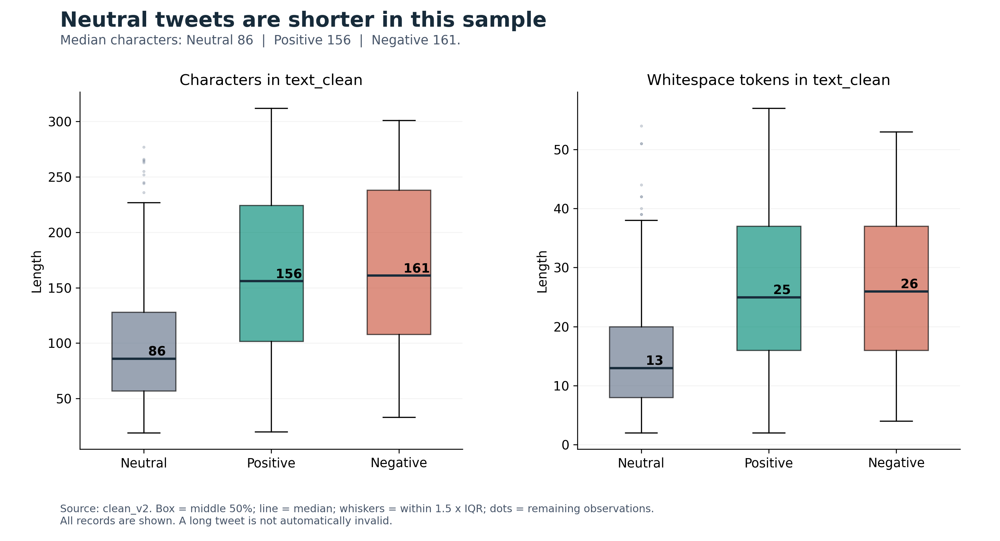

# What an analyst needs

- See which market narratives are changing.
- Classify individual posts as neutral, positive or negative.
- Inspect the supporting text and escalate ambiguous cases for review.

# The data and its limits

- 1,698 raw tweets from 2022, 1,525 retained.
- Labels supplied with the course dataset.
- Raw-text VADER agrees with 92.06% of the development labels. We use it only to diagnose the target.

# Neutral posts are shorter

{width=8.5in}

# A fair comparison starts with the split

- 1,222 development records and 303 historical reserve records.
- Five frozen validation folds. Related tweets stay in the same group and fold.
- Fit FastText and trainable preprocessing inside the relevant training partition.
- Select early-stopping epochs inside the outer training partition.

# Representations and candidates

| Representation | Classifiers |
|---|---|
| Sparse word TF-IDF | Logistic regression reference |
| Scratch-trained FastText | MLP, BiLSTM, kNN variants |
| Frozen SBERT sentence vectors | SVM, kNN, XGBoost |
| Frozen SBERT token vectors | TextCNN |

# Development model comparison

| Method | OOF Macro-F1 |
|---|---:|
| Fixed / tuned TF-IDF baseline | 58.20% / 61.35% |
| SBERT SVM / kNN | 59.85% / 53.95% |
| XGBoost / FastText MLP | 57.89% / 53.45% |
| TextCNN / corrected BiLSTM | 61.79% / 52.11% |

# Equal-weight fusion

- TextCNN leads the tuned baseline by only 0.44 points. Historical selection protocols vary.
- Average the tuned baseline and TextCNN probabilities for each development tweet.
- **66.39% Macro-F1**, a 5.04-point increase over the tuned baseline on these predictions.
- One model is right and the other wrong on 452 of the 1,222 development posts.
- The combination was proposed after seeing development results. Confirm it on independent data.

# When the ensemble misses

- Row 173 · A short position and a denial of an imminent crash appear together.
- Row 594 · The author rejects the characterization of the situation as a crash.
- Row 1316 · The word “bear” is used as a verb and as market terminology.

# What to do with the output

1. Report class proportions and tweet counts by market.
2. Open low-confidence posts and model disagreements for human review.
3. Confirm the frozen combination on new annotations before using it to guide decisions.

Earlier experiments reported scores on the historical reserve. This review reports development results.
